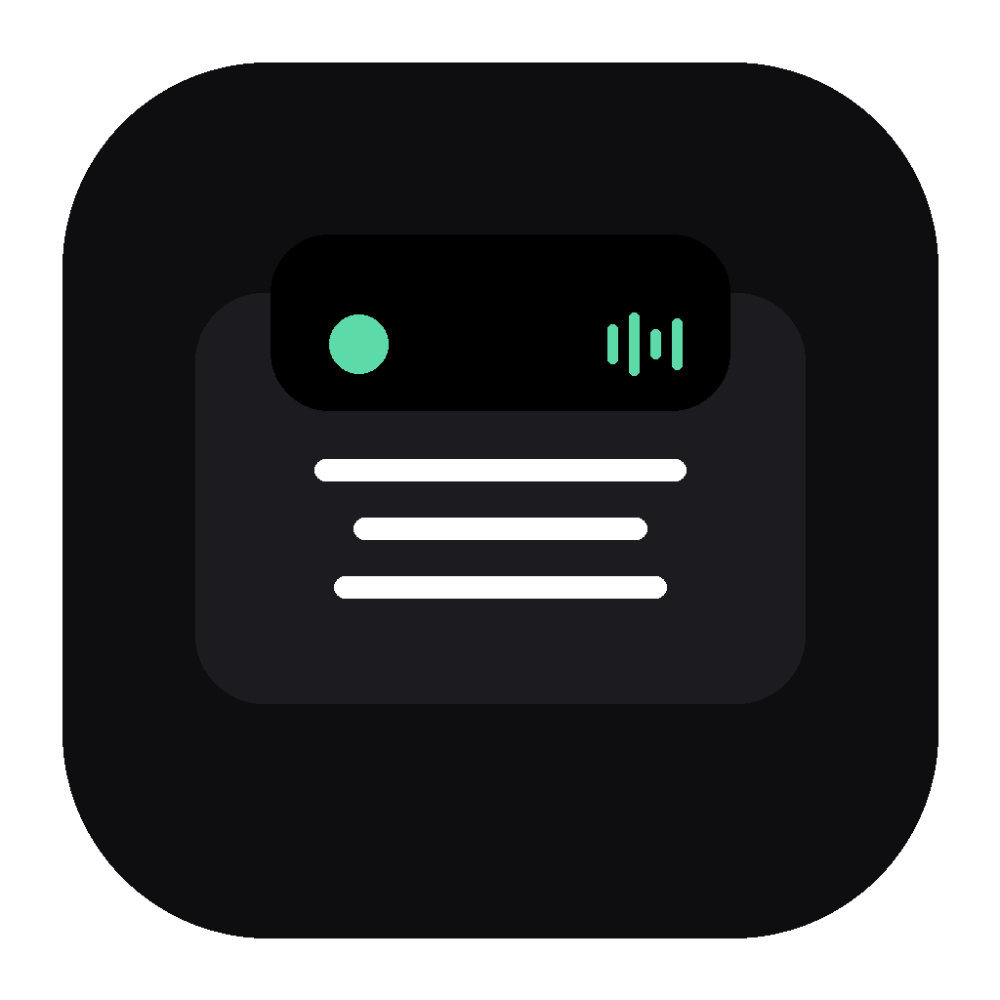
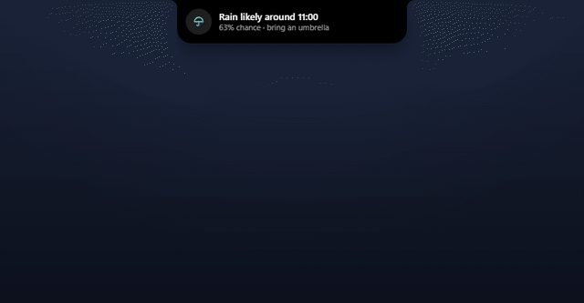
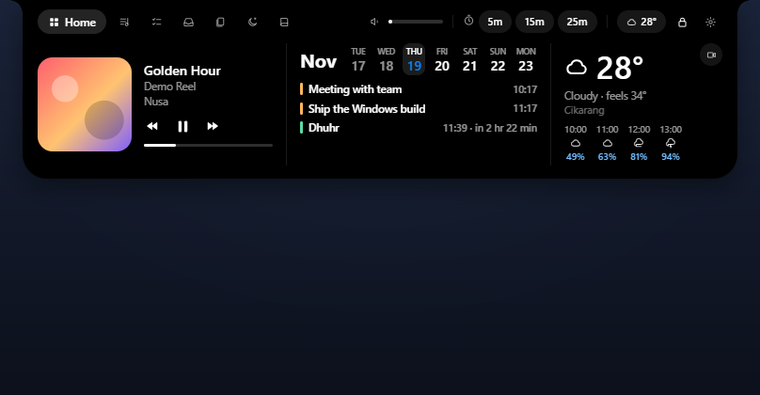
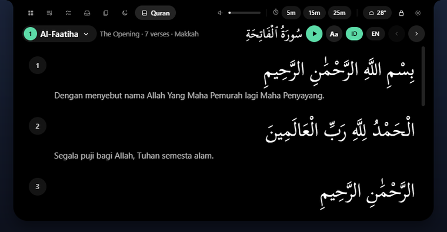
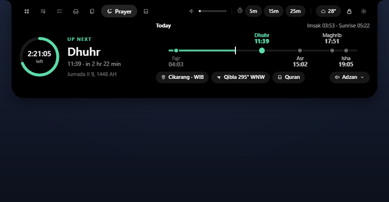
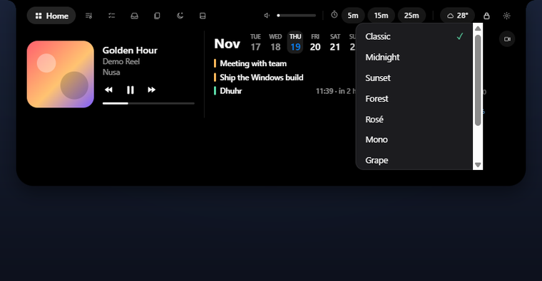

<div align="center">



# Nusa

**The Dynamic Island for your desktop.**

Music, tasks, prayer times, Quran, weather and focus — living in a notch at the top of your screen.
Click it, and it unfolds into a full panel.

[](#-install)
[](https://github.com/Hiroyki/nusa/releases/latest)
[](#-project-structure)
[](#-build-from-source)
[](desktop/themes/README.md)
[](https://github.com/Hiroyki/nusa/issues)

<br>



<sub><b>Expand · switch tabs · swap themes</b> — all in motion.</sub>

</div>

---

## 📖 Table of contents

- [Why Nusa?](#-why-nusa)
- [Features](#-features)
- [Gallery](#-gallery)
- [Install](#-install)
- [Themes](#-themes)
- [Tips & tricks](#-tips--tricks)
- [Build from source](#-build-from-source)
- [Project structure](#-project-structure)
- [FAQ](#-faq)
- [Roadmap](#-roadmap)
- [Credits](#-credits)

## 🤔 Why Nusa?

Most Dynamic-Island / menu-bar companions live only on macOS. **Nusa runs everywhere** — a native
**SwiftUI** app on the Mac and an **Electron** build on Windows & Linux — so you get the same glanceable
notch no matter which machine you're on.

- 🪶 **Quiet by default** — a thin bar at the top edge, out of the way until you need it.
- 🖱️ **Click-through** — everything around the notch passes clicks straight to the app behind it.
- 👀 **Glanceable** — now-playing, next prayer, weather and tasks without stealing focus.
- 🎨 **Yours** — pick one of 8 themes or bring your own in a few seconds.
- 🔒 **Local-first** — prayer times, tasks and settings stay on your device.

## ✨ Features

| | Feature | What it does | Windows | macOS | Linux |
|:--:|---|---|:--:|:--:|:--:|
| 🎵 | **Now Playing** | HD artwork, source-app icon, seek bar, click the cover to jump to the app | ✅ | ✅ | ✅ |
| ▶️ | **Music** | Senandung queue + search, or control whatever app is playing | ✅ | ✅ | ✅ |
| ✅ | **Tasks** | Natural language: *"Rapat QC besok jam 9"*, *"Call Budi in 30 min"* | ✅ | ✅ | ✅ |
| 🎯 | **Focus** | 25-minute focus sessions, breaks, daily streak | ✅ | ✅ | ✅ |
| 🕌 | **Prayer** | Prayer times (Kemenag criteria), qibla, adhan, 10-min reminder | ✅ | ✅ | ✅ |
| 📖 | **Quran** | 114 surahs, ID/EN translation, reciters, last-read bookmark | ✅ | ✅ | ✅ |
| ☁️ | **Weather** | Temp, feels-like, hourly outlook, rain warnings | ✅ | ✅ | ✅ |
| 🗂️ | **Tray** | Drop files on the notch to keep them, drag back out to use | ✅ | ✅ | ✅ |
| 📋 | **Clips** | Clipboard history, one click to copy again | ✅ | ✅ | ✅ |
| 🎨 | **Themes** | 8 built-in looks + import your own `.json` | ✅ | — | ✅ |
| 🔊 | **System** | Volume, battery, audio-device switch pop-up | ✅ | ✅ | ✅ |
| 📅 | **Calendar** | Today's events + tasks due | ✅ | — | — |
| 🪞 | **Mirror** | Selfie camera, only turns on when you click it | ✅ | ✅ | — |

> On Windows & Linux the notch is a **slim bar** at the very top so it never covers your browser tabs — it grows as your cursor gets close.

## 📸 Gallery

<div align="center">

| Home | Music |
|:---:|:---:|
|  |  |
| **Tasks** | **Quran** |
|  |  |
| **Prayer** | **Your own theme** |
|  |  |

</div>

## 🚀 Install

<details open>
<summary><b>🪟 Windows 10/11 (64-bit)</b></summary>

Download **`Nusa-Setup-x.y.z.exe`** from [Releases](https://github.com/Hiroyki/nusa/releases/latest) and run the wizard.

> See *"Windows protected your PC"*? Click **More info → Run anyway** — the installer isn't code-signed yet.

</details>

<details>
<summary><b>🍎 macOS 14 Sonoma+ (Apple Silicon & Intel)</b></summary>

Easiest: open **Terminal** and paste:

```sh
curl -fsSL https://raw.githubusercontent.com/Hiroyki/nusa/main/install.sh | sh
```

It downloads `Nusa-macOS.zip` from the latest release, installs it to Applications and launches it.

**Why not just download the zip in a browser?** Nusa isn't signed with an Apple developer account yet, so
macOS blocks browser-downloaded files with *"Apple could not verify Nusa…"*. If you already downloaded it:

1. Move `Nusa.app` to Applications, open it once (you'll get that dialog), click **Done**.
2. Open **System Settings → Privacy & Security** and click **Open Anyway** next to Nusa.
3. Or from Terminal: `xattr -dr com.apple.quarantine /Applications/Nusa.app`

Permissions (Calendar, Camera, Bluetooth) are only requested when a feature needs them.

</details>

<details>
<summary><b>🐧 Linux</b></summary>

- **Ubuntu / Debian:** `sudo apt install ./Nusa-x.y.z-amd64.deb`
- **Any distro:** `chmod +x Nusa-x.y.z-x86_64.AppImage && ./Nusa-x.y.z-x86_64.AppImage`
- Now-playing needs `playerctl` — `sudo apt install playerctl`.

</details>

## 🎨 Themes

Nusa ships with **8 built-in themes** — **Classic · Midnight · Sunset · Forest · Rosé · Mono · Grape · Ocean** —
and you can bring your own.

A theme is just a small `.json` file. Import it from any of these:

- ⚙️ gear icon in the panel → **Import theme…**
- 🖱️ right-click the notch → **Import theme…**
- 🗂️ system tray menu → **Import theme…**
- 📥 **drop the `.json` straight onto the notch**

```json
{
  "name": "Neon",
  "colors": { "mint": "#39ff14", "bg": "#070b07", "late": "#ff4d6d" },
  "font": "'Segoe UI', system-ui, sans-serif"
}
```

Every field is optional — anything you leave out falls back to the default dark look. Switch back any time
with **Theme → Reset to Classic**. Full format & example in [`desktop/themes/`](desktop/themes/README.md).

<div align="center"></div>

## 🕹️ Tips & tricks

| Do this | And… |
|---|---|
| **Click** the notch | Opens the panel |
| **Esc** / click away | Closes the panel |
| **Right-click** the notch | Open at login · Import theme · Quit |
| **Two-finger swipe** left/right on the notch | Previous / next track |
| **Drag files** onto the notch | Saves them in **Tray** — drag them out to use |
| **Drag the progress bar** | Seek through the track |
| **Drag the volume bar** | Change system volume |
| **Click the album art** | Jumps to the app that's playing |
| **Click the weather chip** | Hourly forecast |
| **📹 button** (Home) | Toggles the camera mirror |
| **Hover** the notch | Expands to show what's playing |

## 🛠 Build from source

<details>
<summary><b>macOS — native SwiftUI app</b></summary>

```sh
./build.sh            # build, install to ~/Applications and relaunch
./build.sh --no-install
```

Needs Xcode Command Line Tools (`swiftc`, `clang`) and Python 3 + Pillow for the icon.

</details>

<details>
<summary><b>Windows / macOS / Linux — Electron app (with themes)</b></summary>

```sh
cd desktop
npm install          # if Electron didn't download: node node_modules/electron/install.js
npm test             # prayer-time & task-parser tests
npm start            # development
npm run dist:win     # Windows installer  -> desktop/dist/Nusa-Setup-*.exe
npm run dist:linux   # AppImage + .deb     -> desktop/dist/
npm run dist:mac     # dmg + zip (Intel & Apple Silicon) -> desktop/dist/
```

> **Cross-platform builds.** Each target must be built on its own OS — `.exe` on Windows, `.dmg` on macOS,
> `.AppImage`/`.deb` on Linux. There's no cross-build from Windows.
> [`.github/workflows/desktop.yml`](.github/workflows/desktop.yml) builds them on GitHub Actions
> (push to `main`, a `v*` tag, or manually). macOS & Linux are **turned off for now** — only Windows is released.

</details>

## 🗂 Project structure

| Path | What's inside |
|---|---|
| `Sources/` | Native macOS SwiftUI app (notch, panel, Home/Music/Tasks/Tray/Clips/Prayer/Quran tabs) |
| `helper/` | Now-playing reader — a dylib loaded by `/usr/bin/perl`, since macOS 15.4+ blocks MediaRemote for regular apps |
| `desktop/` | Electron app for **Windows, macOS & Linux**, plus the theme system |
| `assets/` | Adhan audio, Quran data, Arabic fonts — sources & licenses in [`assets/CREDITS.md`](assets/CREDITS.md) |
| `docs/` | Demo GIF and screenshots used in this README |

## ❓ FAQ

<details>
<summary><b>Is it really free? What's the catch?</b></summary>

It's a personal project. No accounts, no telemetry — prayer times, tasks and settings stay local.

</details>

<details>
<summary><b>Why does SmartScreen / Gatekeeper warn me?</b></summary>

Because the builds aren't code-signed yet. On Windows click **More info → Run anyway**; on macOS use the
**Open Anyway** flow or the `xattr` command above.

</details>

<details>
<summary><b>Does the macOS app have themes?</b></summary>

Not yet. Themes currently live in the desktop (Electron) build. Porting them to the native SwiftUI app is on the roadmap.

</details>

<details>
<summary><b>Where are my custom themes stored?</b></summary>

In the app's user-data folder — on Windows `%APPDATA%\Nusa\themes\`.

</details>

<details>
<summary><b>Why is the notch sometimes invisible?</b></summary>

It fades out of the way when a screen-recording toolbar or a share bar appears in the top-center, so it never blocks them.

</details>

## 🗺️ Roadmap

- [x] Windows / macOS / Linux desktop apps
- [x] Themes — 8 built-in + import your own
- [ ] Themes on the native macOS app
- [ ] Curated theme gallery
- [ ] Custom prayer-time locations
- [ ] Code-signed installers

## 🙏 Credits

- **Prayer times** — [PrayTimes.org](http://praytimes.org) algorithm, Kemenag RI criteria (Fajr 20°, Isha 18°, Asr Shafi'i).
- **Quran text, translation & reciters** — see [`assets/CREDITS.md`](assets/CREDITS.md).
- **Weather** — [Open-Meteo](https://open-meteo.com).
- **Icons** — hand-drawn SVG, no icon-font dependency.
- Built by **Quraish Rahmatulloh**.

<div align="center"><sub>Made with ☕ — hope it's useful. If you like it, a ⭐ helps a lot.</sub></div>
