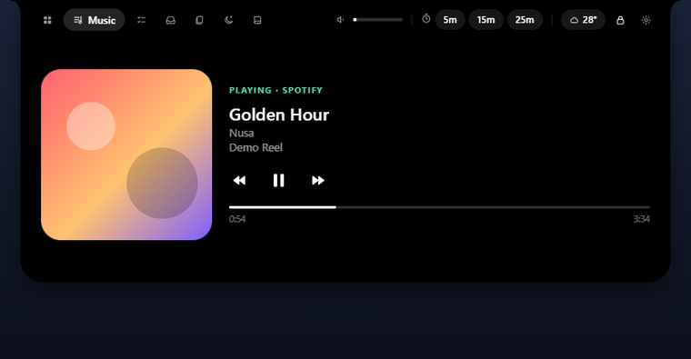
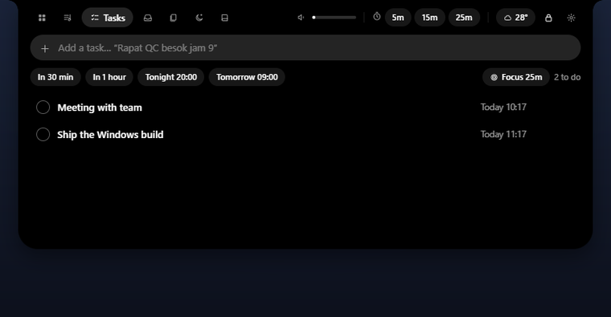
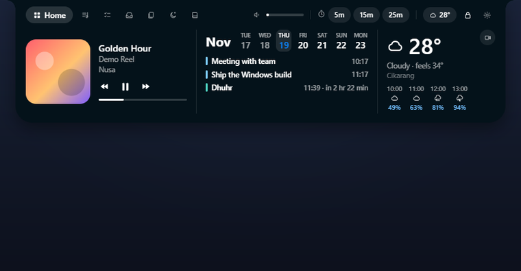

<div align="center">

# 🏝️ Nusa

**Dynamic Island buat desktop kamu** — lagu, pengingat tugas, waktu sholat, Quran, cuaca, dan fokus,
nongkrong manis di notch atas layar. Klik, langsung kebuka jadi panel penuh.

[](#-pasang)
[](#-struktur-repo)
[](#-build-dari-sumber)
[](https://github.com/Hiroyki/nusa/releases/latest)


</div>

---

## ✨ Fitur

| | | |
|---|---|---|
| 🎵 **Now Playing** | Sampul HD, ikon app sumber, geser posisi lagu, sampul diklik buat buka app-nya | Windows · macOS · Linux |
| ▶️ **Music** | Antrean Senandung + cari lagu, atau pemutar dari app apa aja | Windows · macOS · Linux |
| ✅ **Tasks** | Ketik natural: *"Rapat QC besok jam 9"*, *"Call Budi in 30 min"* | Windows · macOS · Linux |
| 🎯 **Focus** | Sesi fokus 25 menit, istirahat, hitungan harian | Windows · macOS · Linux |
| 🕌 **Prayer** | Jadwal sholat (Kemenag), kiblat, adzan, pengingat 10 menit sebelum | Windows · macOS · Linux |
| 📖 **Quran** | 114 surah, terjemahan ID/EN, murottal, bookmark ayat terakhir | Windows · macOS · Linux |
| ☁️ **Cuaca** | Suhu, terasa, prakiraan jam-jaman, peringatan hujan | Windows · macOS · Linux |
| 🗂 **Tray** | Drop file ke notch, disimpen buat nanti, bisa diseret keluar | Windows · macOS · Linux |
| 📋 **Clips** | Riwayat clipboard teks, tinggal klik buat copy lagi | Windows · macOS · Linux |
| 🎨 **Tema** | 8 tema bawaan + impor tema sendiri (`.json`) | Windows · Linux |
| 🔊 **Sistem** | Volume, baterai, pop-up ganti perangkat audio | Windows · macOS · Linux |
| 📅 **Kalender** | Agenda hari ini + tugas jatuh tempo | Windows · macOS |
| 🪞 **Cermin** | Kamera selfie, cuma nyala pas diklik | Windows · macOS |

> Notch di Windows & Linux tampil **tipis di tepi atas** biar nggak nutup tab browser, membesar pas kursor mendekat.

## 📸 Galeri

<div align="center">

| Home | Music |
|:---:|:---:|
|  |  |
| **Tasks** | **Quran** |
|  |  |
| **Prayer** | **Tema sendiri** |
|  |  |

</div>

## 📥 Pasang

<details open>
<summary><b>🪟 Windows 10/11 (64-bit)</b></summary>

Unduh **`Nusa-Setup-x.y.z.exe`** dari [Releases](https://github.com/Hiroyki/nusa/releases/latest) lalu jalanin wizard-nya.

> Muncul *"Windows protected your PC"*? Klik **More info → Run anyway** — installer belum ditandatangani.

</details>

<details>
<summary><b>🍎 macOS 14 Sonoma+ (Apple Silicon & Intel)</b></summary>

Paling gampang, buka **Terminal** lalu tempel:

```sh
curl -fsSL https://raw.githubusercontent.com/Hiroyki/nusa/main/install.sh | sh
```

Script itu ngunduh `Nusa-macOS.zip` dari Release, masang ke Applications, terus buka Nusa.

**Kenapa nggak cukup unduh zip dari browser?** Nusa belum ditandatangani pakai akun developer Apple, jadi file dari
browser diblok macOS dengan pesan *"Apple could not verify Nusa…"*. Kalau udah terlanjur unduh:

1. Pindahin `Nusa.app` ke folder Applications, buka sekali (muncul pesan itu), klik **Done**.
2. Buka **System Settings → Privacy & Security**, klik **Open Anyway** di baris Nusa, masukin password.
3. Atau lewat Terminal: `xattr -dr com.apple.quarantine /Applications/Nusa.app`

Izin (Kalender, Kamera, Bluetooth) diminta cuma kalau fiturnya dipakai.

</details>

<details>
<summary><b>🐧 Linux</b></summary>

- **Ubuntu/Debian:** `sudo apt install ./Nusa-x.y.z-amd64.deb`
- **Distro lain:** `chmod +x Nusa-x.y.z-x86_64.AppImage && ./Nusa-x.y.z-x86_64.AppImage`
- Info lagu butuh `playerctl` (`sudo apt install playerctl`).

</details>

## 🎨 Tema sendiri

Nusa punya 8 tema bawaan — **Classic · Midnight · Sunset · Forest · Rosé · Mono · Grape · Ocean** — dan kamu bisa bawa tema sendiri.

Tema cuma file `.json` kecil. Impor lewat salah satu cara ini:

- ⚙️ gerigi di panel → **Import theme…**
- 🖱️ klik-kanan notch → **Import theme…**
- 🗂️ menu tray → **Import theme…**
- 📥 **drop file `.json`-nya langsung ke notch**

```json
{
  "name": "Neon",
  "colors": { "mint": "#39ff14", "bg": "#070b07", "late": "#ff4d6d" },
  "font": "'Segoe UI', system-ui, sans-serif"
}
```

Semua field opsional — yang nggak diisi pakai nilai bawaan. Balik ke tema bawaan lewat **Theme → Reset to Classic**.
Format lengkap & contoh di [`desktop/themes/`](desktop/themes/README.md).

<div align="center"></div>

## 🛠 Build dari sumber

<details>
<summary><b>macOS (app SwiftUI native)</b></summary>

```sh
./build.sh            # build, pasang ke ~/Applications, buka ulang
./build.sh --no-install
```

Butuh Xcode Command Line Tools (`swiftc`, `clang`) dan Python 3 + Pillow buat ikon.

</details>

<details>
<summary><b>Windows / macOS / Linux (Electron, ada tema)</b></summary>

```sh
cd desktop
npm install          # kalau Electron belum keunduh: node node_modules/electron/install.js
npm test             # tes jadwal sholat & pembaca tugas
npm start            # jalanin buat development
npm run dist:win     # installer Windows (wizard)  -> desktop/dist/Nusa-Setup-*.exe
npm run dist:linux   # AppImage + .deb             -> desktop/dist/
npm run dist:mac     # dmg + zip (Intel & Apple Silicon) -> desktop/dist/
```

> **Build lintas sistem.** Tiap target harus dibuild di sistem yang sesuai — `.exe` di Windows, `.dmg` di macOS,
> `.AppImage`/`.deb` di Linux. Nggak bisa silang dari Windows.
> Workflow [`.github/workflows/desktop.yml`](.github/workflows/desktop.yml) bikin-nya otomatis di GitHub Actions
> (push ke `main`, tag `v*`, atau manual). Untuk sementara **macOS & Linux dimatikan** dulu — cuma Windows yang dirilis.

</details>

## 🗂 Struktur repo

| Folder | Isi |
|---|---|
| `Sources/` | App SwiftUI native macOS (notch, panel, tab Home/Music/Tasks/Tray/Clips/Prayer/Quran) |
| `helper/` | Pembaca Now Playing (dylib yang dimuat `/usr/bin/perl`, karena macOS 15.4+ ngeblok MediaRemote) |
| `desktop/` | Versi Electron buat **Windows, macOS & Linux** + sistem tema |
| `assets/` | Adzan, data Quran, font Arab — sumber & lisensi di [`assets/CREDITS.md`](assets/CREDITS.md) |
| `docs/` | GIF demo & screenshot buat README/release |

## 📝 Catatan

- Versi **macOS native** (SwiftUI) belum punya fitur tema — yang punya tema itu versi desktop (Electron).
- Belum ditandatangani (Windows SmartScreen / macOS Gatekeeper bakal ngingetin). Normal, tinggal **Run anyway**.
- Ketemu bug atau ada ide? [Buka issue](https://github.com/Hiroyki/nusa/issues) ya.

<div align="center"><sub>Dibuat dengan ☕ — Semoga bermanfaat.</sub></div>
